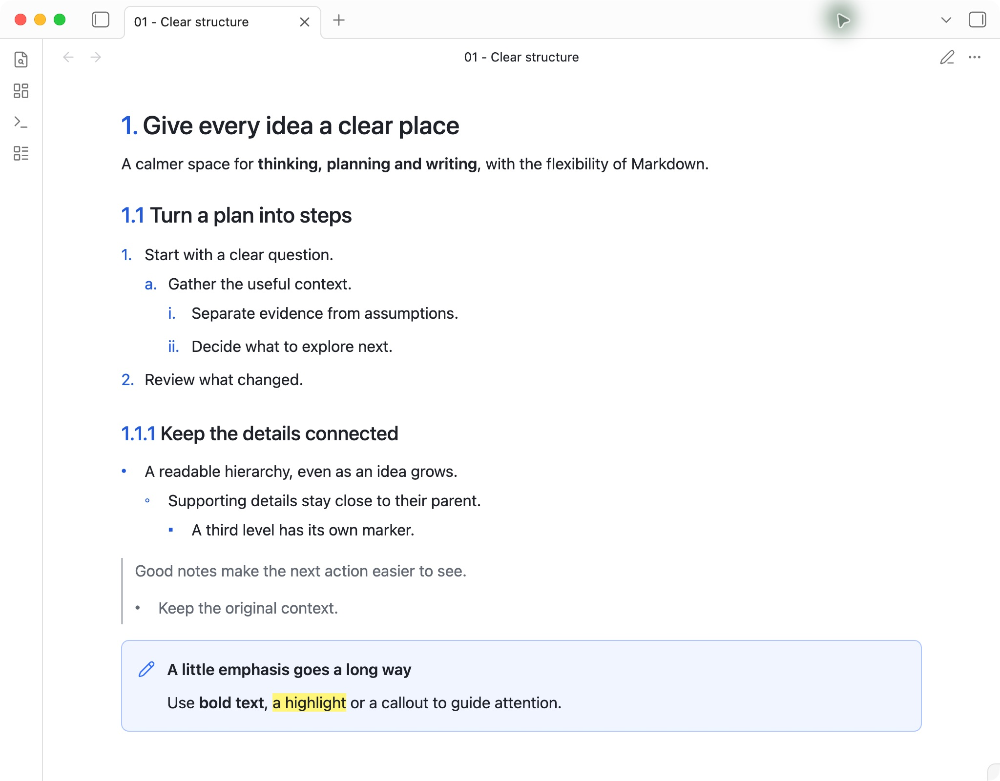
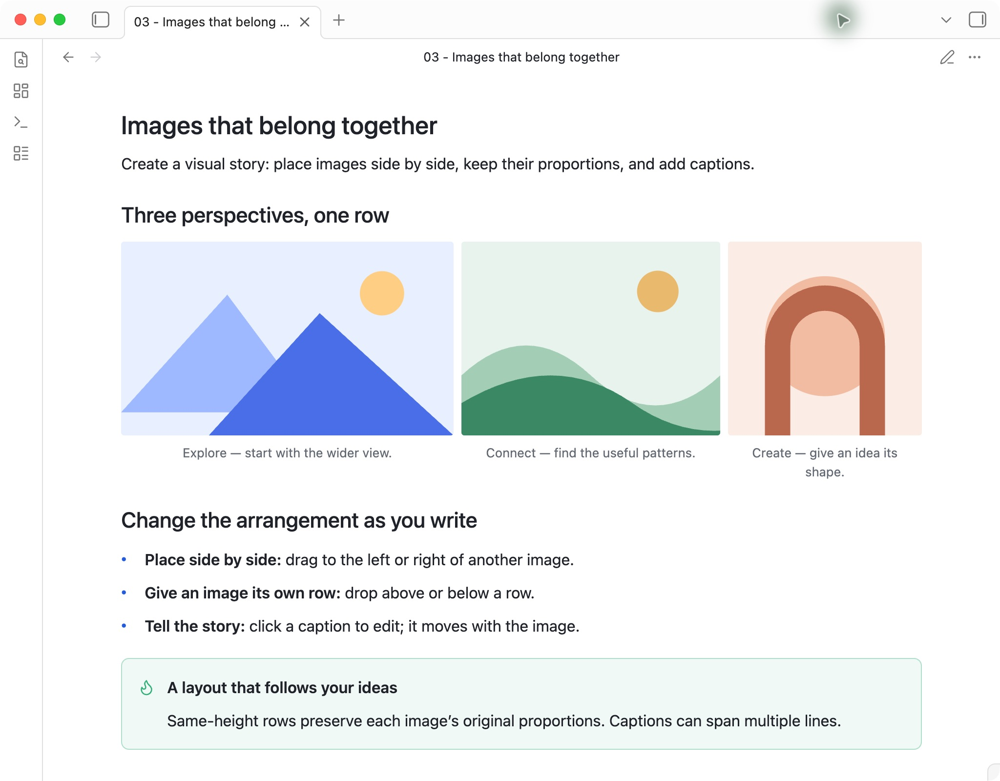
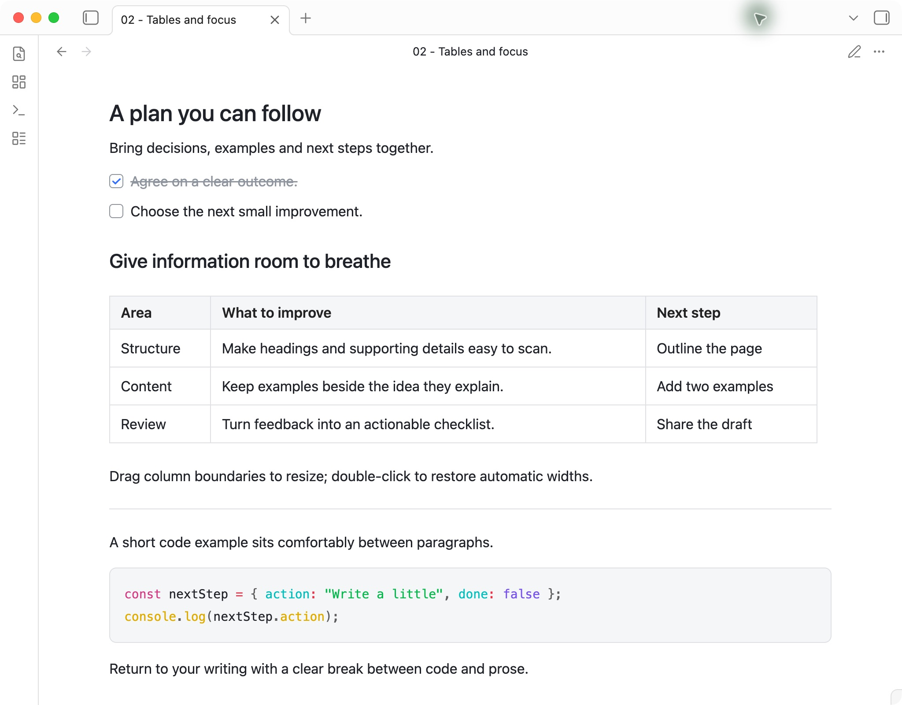

# Feishu Document Layout

Give your Markdown notes the clarity of a document: distinct headings, readable lists, spacious tables and image rows with captions. Inspired by Feishu/Lark, with support for Live Preview and Reading view.

[**Install from the community directory**](https://community.obsidian.md/plugins/feishu-document-layout) · [中文说明](#中文说明) · [Example note](example.md)

## See the layout

### A clear hierarchy, from the big idea to the details

Headings stand apart from body text. Ordered headings show `1.`, `1.1` and `1.1.1`; nested lists use distinct markers at each level. Quotes and callouts keep supporting information easy to find.



### Images that tell a story together

Drag images into a row, reorder them or give one its own row. Images keep their proportions, and editable captions stay with each image.



### Space for information and action

Completed tasks fade into the background. Tables fill the document width with adjustable columns, while code blocks and dividers give each section a clear boundary.



*Actual screenshots of version 1.2.0 in Obsidian 1.12.7 on macOS, using the default light theme and this plugin. The examples use sample content. Minimal is optional.*

## Installation

1. Open the [community listing](https://community.obsidian.md/plugins/feishu-document-layout) and click **Add to Obsidian**. Allow your browser to open Obsidian if prompted.
2. In Obsidian, choose **Install**, then **Enable**.
3. Open a note in **Live Preview** or **Reading view** to see the layout.

You can also install from inside Obsidian: **Settings → Community plugins → Browse**, search for **Feishu Document Layout**, then select **Install → Enable**. If prompted, turn on community plugins first.

For future updates, use **Settings → Community plugins → Check for updates**. Try the Markdown in [example.md](example.md) in a note of your own.

<details>
<summary>Manual installation from GitHub</summary>

1. Download `main.js`, `manifest.json` and `styles.css` from the [latest GitHub release](https://github.com/GasonW/feishu-document-layout/releases/latest).
2. Create `.obsidian/plugins/feishu-document-layout/` inside your vault and place the three files there.
3. Open **Settings → Community plugins**, reload the plugin list and enable **Feishu Document Layout**. Obsidian must allow community plugins in this vault.

</details>

This is a layout plugin that works with your selected Obsidian theme. The theme continues to style application controls and properties that the plugin does not override.

This community project is unaffiliated with Feishu, Lark or Obsidian. Licensed under the [MIT License](LICENSE). [Report an issue](https://github.com/GasonW/feishu-document-layout/issues).

## Usage

- **Ordered headings:** Write `# 1. Chapter`, `## 1. Section` and `### 1. Topic` to display `1.`, `1.1` and `1.1.1` in the document and outline. These markers form a sequence: repeated `1.` markers advance sibling numbers. Ordinary headings such as `# Chapter` retain their normal appearance. Adding or removing an ordered heading updates subsequent numbers.
- **Lists:** Use standard Markdown indentation. Ordered lists display decimal, alphabetic and Roman markers; unordered lists display solid circles, hollow circles and squares. Each level adds 24px of indentation.
- **Blockquotes:** Prefix each line with `>`. Lists and their nested levels render inside the quote border.
- **Tasks:** Use `- [ ]` and `- [x]`. Completed tasks display muted text, a strikethrough and a blue checkmark.
- **Tables:** Tables fill the document area up to 820px. Drag a boundary between header cells to resize the neighboring columns. Double-click that boundary to restore automatic widths.
- **Images:** Drag an image to another image's left or right to place them in one row. A blue indicator marks the destination. Drop near the top or bottom to create a separate row. Images keep their aspect ratios and share the same height. The image menu also provides left/right movement and **Move to next row**.
- **Captions:** Hover over an image and choose **Add caption**. Enter saves, Shift+Enter adds a line, and Escape cancels. Click an existing caption to edit; clear its text to delete it. Captions move with their image.

```markdown
# 1. Chapter
## 1. Section
### 1. Topic

> Context
>
> - First level
>   - Second level
>     - Third level
>
> 1. First step
>    1. Substep
>       1. Detail
```

### Ordered heading settings

Enable rendering of ordered heading markers in **Settings → Feishu Document Layout**. This capability is enabled by default. A note's YAML property takes precedence over that setting:

```yaml
---
heading-numbering: false
---
```

Set the property to `true` to enable numbering in that note. The command **Toggle numbered heading rendering in this note** updates this property from either Live Preview or Reading view.

The source marker is rendered as a hierarchical number. Markdown text and link targets retain their original names. Ordinary headings do not advance or reset this sequence. The first marker at each level sets its starting value; `# 3. Chapter` starts at `3.`. Missing numbered ancestors start at `1`, so `## 1. Section` starts at `1.1`. Fixed prefixes such as `1.1` remain literal. Escape a literal list-like prefix as `1\. Text`.

The active list or ordered heading line shows editable Markdown markers. Move the cursor away to see its formatted marker. Source mode shows the original Markdown.

### Creation time

New Markdown notes automatically receive a `created` property in their YAML frontmatter:

```yaml
---
created: 2026-11-13T15:55:27
---
```

The value uses the file's creation time in your local timezone. Editing or renaming a note keeps the recorded value. Any existing `created` property is preserved, including an empty one. You can select **Date & time** from the property's type menu in Obsidian.

To fill existing notes, use **Settings → Feishu Document Layout → 补全全库**, or run **Fill missing creation times in all notes** from the command palette. **Add creation time to this note** fills only the active note. These actions preserve existing values and report the number of notes updated or skipped; invalid YAML is left for you to correct. The **自动记录创建时间** toggle controls future automatic recording. Opening a vault does not bulk-update its notes.

For imported, copied or synced files, the current filesystem creation time may differ from the original writing date. Once recorded in YAML, the value travels with the note. Obsidian's frontmatter API may normalize YAML formatting when adding the property; the body and existing property values are retained.

## Data and privacy

The plugin reads individual files through the Obsidian vault API to determine heading numbers and image rows. Settings and column proportions are stored in the plugin's `data.json` inside the vault. The heading-numbering command updates the current note's frontmatter. Creation-time recording adds a missing `created` property to new notes or notes selected by a fill command. Image dragging rearranges the original Markdown embeds; captions are stored beside each embed in an HTML comment containing an image ID and caption text. These changes travel with the note when it is synced. Live Preview image edits use the editor's undo history.

Local images are loaded through Obsidian's vault API. Images whose Markdown source uses an HTTP(S) URL load from that URL. The plugin has no telemetry or external service account and does not access files outside the vault.

## Compatibility and limitations

- Verified on macOS with Obsidian 1.12.7 and Minimal: Live Preview, Reading view, outline updates, nested lists, quote/list composition, table resizing, typing and clearing table cells, and image layout/captions. Default-theme checks cover blank-line cursor movement, clearing table cells, three-image rows and captions in both views. Mobile and additional themes have not been verified.
- Numbering covers top-level Markdown headings of levels one through three. Fenced code and YAML do not participate.
- Column widths are identified by the note path, table headers and the occurrence of matching headers. Editing headers or changing the column count requires resizing again. Virtual scrolling in long notes containing multiple identical table headers remains a known validation limit.
- Outline and list styling depend on Obsidian's UI structure. Application, theme or other layout-plugin updates may require compatibility adjustments.
- Other Markdown viewers apply their own heading-numbering and table-width rules.
- Image rows use unindented, image-only lines with `![[image.png]]` or `` embeds. Multiple embeds on the same line form one row. Lists, quotes, tables, code, and inline images keep their native rendering. Source mode exposes the editable Markdown and caption metadata. Other Markdown readers can display the images but may not display the captions or row layout.
- Image dragging is within the same note. Single images respect a wiki embed width such as `![[image.png|360]]`; multiple images divide the available row width according to their aspect ratios.

## Development

Node.js 20 or later is required. The build uses Node.js built-in modules and the runtime uses Obsidian's supplied APIs and CodeMirror modules.

```sh
npm ci --ignore-scripts
npm test
npm run build
npm run check
```

`plugin.js` contains the plugin entry source, `editor.js` the document editor extension, and `layout.js` the document parsing functions. `images.js` handles image Markdown edits and `image-view.js` supplies the image interaction UI. `metadata.js` records file creation times. `build.mjs` generates `dist/main.js` and copies the manifest and stylesheet into `dist/`. GitHub Actions runs tests, a build and a syntax check for pushes and pull requests.

Release tags match `manifest.json`. Release attachments are `dist/main.js`, `dist/manifest.json` and `dist/styles.css`.

## 中文说明

为 Obsidian 提供接近飞书文档的阅读排版：清楚的标题层级、嵌套列表、任务状态、引用、高亮块、可调整列宽的表格，以及支持拖拽并排和图注的图片。实时预览与阅读视图均支持。

[**从社区目录安装**](https://community.obsidian.md/plugins/feishu-document-layout) · [查看上方实机截图](#see-the-layout)

- **层级更清楚：** 标题与正文拉开层次，编号标题显示 `1.`、`1.1`、`1.1.1`，三级列表使用不同标记。
- **图片更好组织：** 拖拽并排、调整顺序或拆行；同排等高并保留原始比例，图注跟随图片移动。
- **信息更易扫读：** 已完成任务变灰，表格列宽可调，引用、高亮块、代码块和分割线各有清晰边界。

上方三张截图来自 macOS 上的 Obsidian 1.12.7、插件 1.2.0，使用默认浅色主题和公开样例内容。

## 安装

1. 打开[社区插件页面](https://community.obsidian.md/plugins/feishu-document-layout)，点击 **Add to Obsidian**；浏览器询问时允许打开 Obsidian。
2. 在 Obsidian 中点击 **安装 → 启用**。
3. 打开任意笔记，切换到**实时预览**或**阅读视图**即可使用。

也可以直接在 Obsidian 的 **设置 → 第三方插件 → 浏览** 中搜索 **Feishu Document Layout**，再安装并启用。首次使用时，按提示开启第三方插件。

后续通过 **设置 → 第三方插件 → 检查更新** 获取新版本。完整示例见 [example.md](example.md)。

<details>
<summary>从 GitHub 手动安装</summary>

从 [GitHub Releases](https://github.com/GasonW/feishu-document-layout/releases/latest) 下载 `main.js`、`manifest.json`、`styles.css`，放进库内 `.obsidian/plugins/feishu-document-layout/`，重新加载第三方插件并启用 **Feishu Document Layout**。

</details>

这是独立开发的社区插件，与飞书、Lark 或 Obsidian 官方无关联。采用 [MIT 许可证](LICENSE)。

它是叠加在当前 Obsidian 主题上的排版插件，Minimal 是可选主题。侧栏、应用控件，以及插件未覆盖的属性仍采用所选主题的样式。

## 使用

1. 在需要编号的标题中写 `# 1. 章节`、`## 1. 小节`、`### 1. 主题`，正文与大纲显示 `1.`、`1.1`、`1.1.1`。同级标题可以重复写 `1.`，显示编号会连续递增。普通标题使用 `# 章节`。
2. 嵌套有序列表使用标准数字语法，显示为数字、字母、罗马数字。无序列表显示实心圆、空心圆、方形，每级缩进 24px。
3. 引用行前加 `>`，内部可以继续使用列表和逐级缩进。
4. 表格默认填满正文区域，最大 820px。拖动表头列分隔线调整相邻列比例；双击恢复默认。
5. 已完成的任务显示灰色文字、删除线及蓝色勾选。
6. 将图片拖到另一张的左／右侧，看到蓝色位置线后松开，即可并排；拖到上／下方则单独成行。同排图片保持等高、原始比例。图片菜单也可左右移动或移到下一行。
7. 悬停图片后点击「添加图注」。Enter 保存，Shift+Enter 换行，Esc 取消。点击现有图注可继续修改，清空后保存即可删除。图注跟随图片移动。

```markdown
# 1. 章节
## 1. 小节
### 1. 主题

> 引用说明
>
> - 一级项目
>   - 二级项目
>     - 三级项目
>
> 1. 第一步
>    1. 子步骤
>       1. 具体操作
```

有序标记在显示层替换成层级编号，Markdown 内容与标题链接保持原来的名称。普通标题不参与计数，也不打断编号。每级第一次出现的标记决定起始值，例如 `# 3. 章节` 从 `3.` 开始；缺失的父级按 `1` 计，因此 `## 1. 小节` 从 `1.1` 开始。已有 `1.1` 这样的多级文本前缀保持原样；要显示字面量 `1.`，可写成 `1\.`。

插件默认启用标题有序标记的渲染能力。可在设置中调整，单篇笔记的 YAML 属性优先于全库设置：

```yaml
heading-numbering: false
```

也可以运行命令 **Toggle numbered heading rendering in this note** 切换该属性。光标所在列表或编号标题行显示可编辑的 Markdown 标记；移开光标即可查看排版效果。

### 创建时间

新建 Markdown 笔记时，插件默认将文件创建时间写入顶部的 YAML 属性，例如 `created: 2026-11-13T15:55:27`，采用本地时区。编辑正文或重命名后时间保持不变；已有 `created`（包括留空的值）会保留。可在 Obsidian 的属性类型菜单中将它设为「日期与时间」。

已有笔记可在 **设置 → Feishu Document Layout → 补全全库** 中处理，或运行命令 **Fill missing creation times in all notes**。只补全当前笔记可用 **Add creation time to this note**。补全结束会显示新增、保留及失败数量；YAML 无效的笔记会跳过。设置中的「自动记录创建时间」控制后续自动记录，打开库时不会自动批量改写旧笔记。

导入、复制或同步过的文件，其当前文件创建时间可能与最初写作时间不同。记录到 YAML 后会随笔记同步。添加属性时，Obsidian 可能整理 YAML 格式，正文及已有属性值会保留。

## 本地构建与检查

需要 Node.js 20 或以上，构建使用 Node.js 内置库。

```sh
npm test
node build.mjs
node --check dist/main.js
```

运行时使用 Obsidian 提供的 API 与 CodeMirror。插件设置及列宽保存在库内的插件 `data.json`。切换单篇编号属性会写入 frontmatter；创建时间功能为新笔记或补全命令处理的笔记添加缺失的 `created` 属性；拖动图片会调整原有 Markdown 图片的位置；图注及图片标识保存在紧随图片的 HTML 注释中，随笔记同步。实时预览中的图片修改进入编辑器撤销历史。

本地图片通过 Obsidian 库 API 加载，HTTP(S) 图片按正文中的原地址加载。插件不收集遥测，不需要外部服务账号，也不读取库外文件。

## 验证范围与边界

- 已在 macOS、Obsidian 1.12.7、Minimal 主题核对实时预览、阅读视图、大纲、三级列表与引用叠加、表格列宽、输入后清空单元格，以及图片排版与图注。默认主题已核对空行光标移动、清空单元格，以及两种视图的三图并排和图注。移动端尚待实机验证。
- 标题编号支持文档顶层一至三级 Markdown 标题；代码围栏、YAML 不参与编号。源码模式显示原始 Markdown。
- 列宽按笔记路径、表头内容与同表头表格的次序记录。修改表头或列数后需要重新调整。长文中多张同表头表格的虚拟滚动定位仍需专项验证。
- 大纲及列表样式依赖 Obsidian 的界面结构；应用或主题升级后需复验。其他主题或排版插件的同名样式可能需要协调。
- 在其他 Markdown 阅读器中，标题编号和列宽由对方的显示规则决定。
- 图片排版适用于没有缩进、仅包含图片的行，支持 `![[图片.png]]` 和 ``。同一行的多张图片组成一排。列表、引用、表格、代码与正文行内图片采用原生渲染。源码模式可编辑图片语法和图注元数据；其他 Markdown 阅读器可以显示原图片，但未必支持图注及并排样式。
- 拖拽范围为同一篇笔记。单图遵循 `![[图片.png|360]]` 这样的宽度设置；多图按原始宽高比分配正文区宽度。

## 开发与发布

入口源码为 `plugin.js`，文档编辑器扩展为 `editor.js`，文档解析为 `layout.js`；图片解析及正文修改为 `images.js`，交互界面为 `image-view.js`，创建时间记录为 `metadata.js`。`build.mjs` 生成 `dist/main.js`，并复制 manifest 与样式文件。

每个 Release 的标签与 manifest 版本一致，附件为 `dist/main.js`、`dist/manifest.json`、`dist/styles.css`。GitHub Actions 在提交及 Pull Request 上运行测试与构建检查。
